# User guide

How to use the WDA Konfigurator, page by page. For the command-line tool see §6.

**Contents** — [Connecting](#1-connecting-the-adapter) · [Adapter settings](#2-my-adapter)
· [Firmware](#3-firmware) · [About & log](#4-about) · [App language](#5-app-language)
· [Command line](#6-command-line) · [Troubleshooting](#7-troubleshooting)


## 1. Connecting the adapter

The adapter has no fixed address. It is only reachable while a Miracast session is running, on
a private `192.168.x.x` network Windows creates for it. So the order is always: connect first,
configure second.

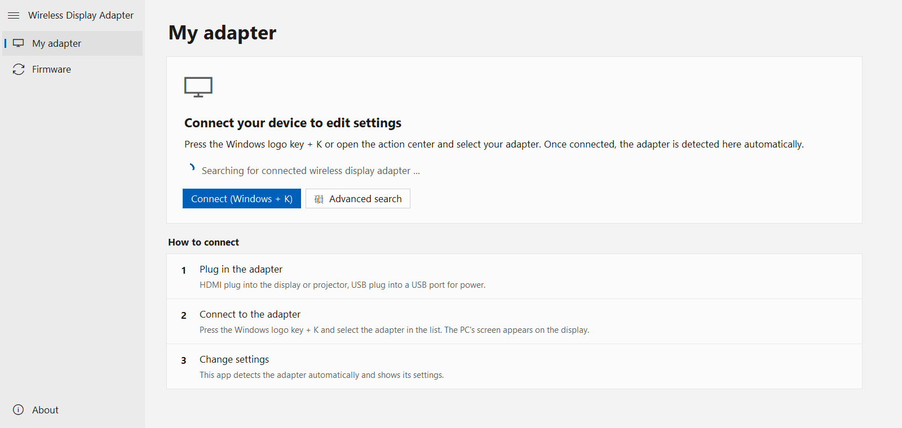

1. Plug the adapter in — HDMI into the display, USB into a power source.
2. Press **Windows logo key + K** (or use the **Connect (Windows + K)** button) and pick the
   adapter from the list. Your screen appears on the display.
3. The app finds the adapter by itself within a second or two. No IP address to type.

If it does not appear, **Advanced search** scans the whole `/24` of every Miracast network your
PC is currently part of. It needs an active connection — without one there is nothing to scan.

Both the app and the CLI can also talk to an adapter at an explicit address if you know it
(`wda_tool.py --host 192.168.137.247 …`).


## 2. My adapter

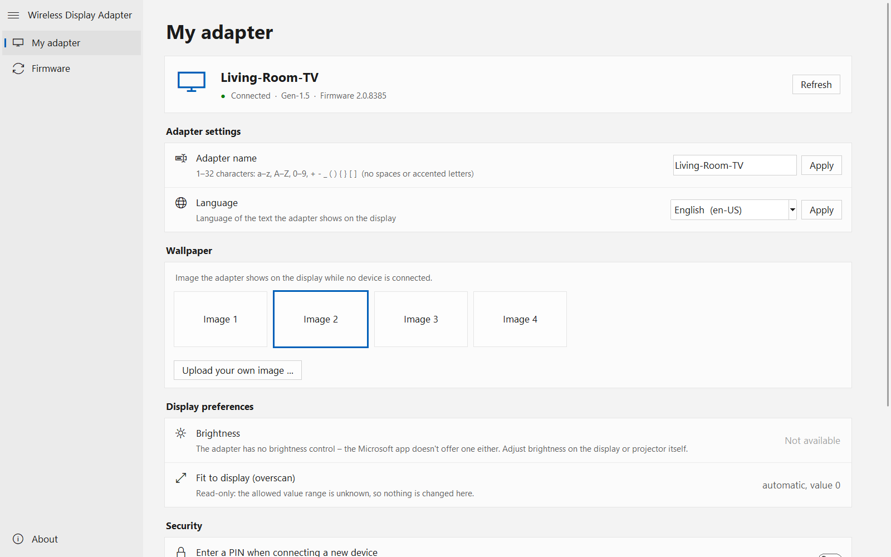

The header shows the name, generation and firmware version. Everything below it is read from
the adapter when it connects; **Refresh** re-reads it.

### Adapter name

The name shown in the Windows connect list and on the adapter's idle screen. The adapter's own
rule is strict: **1–32 characters** out of `a–z`, `A–Z`, `0–9` and `+ - _ ( ) { } [ ]`. No
spaces, no accented letters. The app checks before sending so you get a clear message instead
of error `-3`.

### Language

The language of the text the **adapter** draws on the display — independent of the app's own
language. Only the codes the adapter itself reports are offered. Some adapters require a
restart for this; when they do, a yellow bar with a **Restart adapter** button appears.

### Wallpaper

Only shown if the adapter supports it (Gen 1.5 from firmware 2.0.8385). This is the picture
behind the "ready to connect" screen.

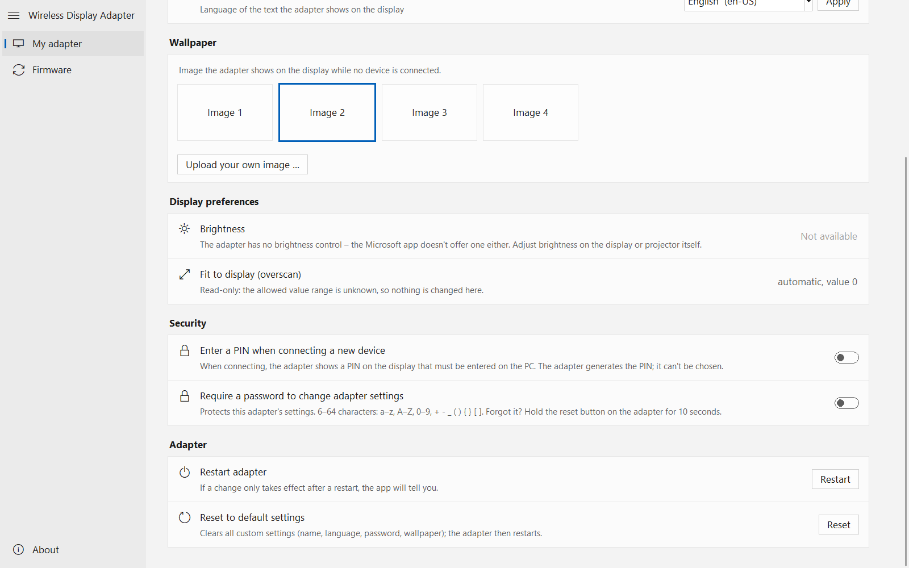

Four images are built into the firmware; click a tile to switch. **Upload your own image …**
takes any picture, fits it to 1920×1080 and uploads the two variants the adapter expects (a
darkened one and a blurred one). That needs Pillow — `python -m pip install pillow`.

> The preview tiles are empty in these screenshots on purpose: the built-in images belong to
> Microsoft and are not redistributed here. On your own adapter the previews appear if you
> built the EXE with a copy of the original app present (see
> [DEVELOPMENT.md](DEVELOPMENT.md#wallpaper-previews)).

### Display preferences

Both entries are informational:

* **Brightness** — not available. The adapter has no brightness command, and the original
  Microsoft app did not offer one either. Adjust it on the display or projector.
* **Fit to display (overscan)** — read-only. The adapter reports its current mode and value,
  but the valid range is not documented anywhere, and guessing could leave the picture
  unusable. It is shown, never written.

### Security

* **Enter a PIN when connecting a new device** — when on, the adapter shows a PIN on the
  display that has to be typed on the PC. The adapter generates it; it cannot be chosen.
* **Require a password to change adapter settings** — protects the settings, not the video
  link. **6–64 characters** from `a–z`, `A–Z`, `0–9`, `+ - _ ( ) { } [ ]`. Once on, the app
  asks for the password the first time you change something and remembers it for the session.

> **Forgotten password?** Hold the reset button on the adapter for 10 seconds. There is no
> software way around it.

### Restart and reset

**Restart** reboots the adapter — you will need to reconnect with Windows + K afterwards.
**Reset** clears name, language, password and wallpaper and restarts the adapter. Both ask
first:

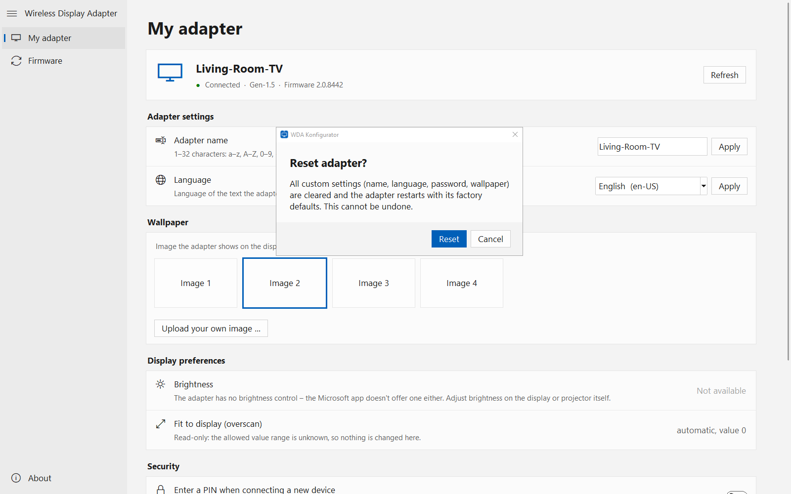

### The stability warning

Updates and resets are the two operations that genuinely must not be interrupted, so the app
watches the Miracast link in the background (once a second) and considers it stable only when
it has been up for 20 s with no dropout in the last 60 s. If it is not, you get a warning —
with **Try anyway** still available, since it is your adapter.

A link that keeps dropping every ~13 s is almost always HDCP on firmware 2.0.8350. Either
update the adapter from a different PC, or turn off HDCP support in the graphics driver first.


## 3. Firmware

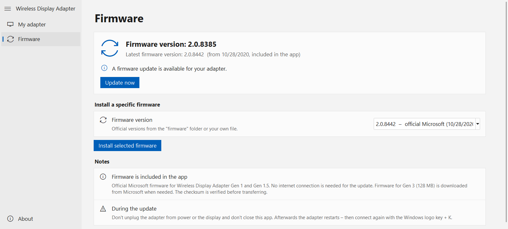

The page compares the version running on the adapter with the newest one available and offers a
single button. Firmware comes from Microsoft's own servers; nothing is bundled with this
project. The first time a generation is needed, the app downloads it and keeps it in
`%LOCALAPPDATA%\WDA-Konfigurator\firmware` (or the `firmware/` folder when running from
source), so later updates work offline.

Everything downloaded is checked twice: against the size Microsoft publishes in its version
manifest, and against the SHA-256 recorded in `firmware.json` — the second check runs again
every time the file is read, immediately before it goes to the adapter.

During the update:

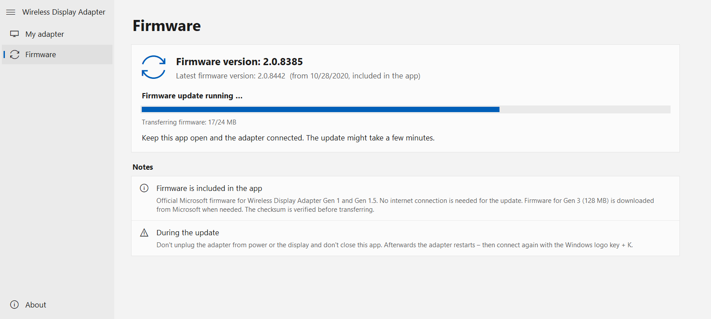

**Do not unplug the adapter and do not close the app.** The transfer is 18–128 MB depending on
the generation, then the adapter writes flash and reboots on its own. If the transfer itself
breaks off, nothing is lost — the adapter discards an incomplete image and keeps its current
firmware, and the app retries once. When the adapter stops answering near 100 %, that is it
rebooting; reconnect with Windows + K and check the version.

### Choosing a specific version

Every version in the local library is listed, newest first, so you can deliberately install an
older one — useful with the 2.0.8350 HDCP problem.

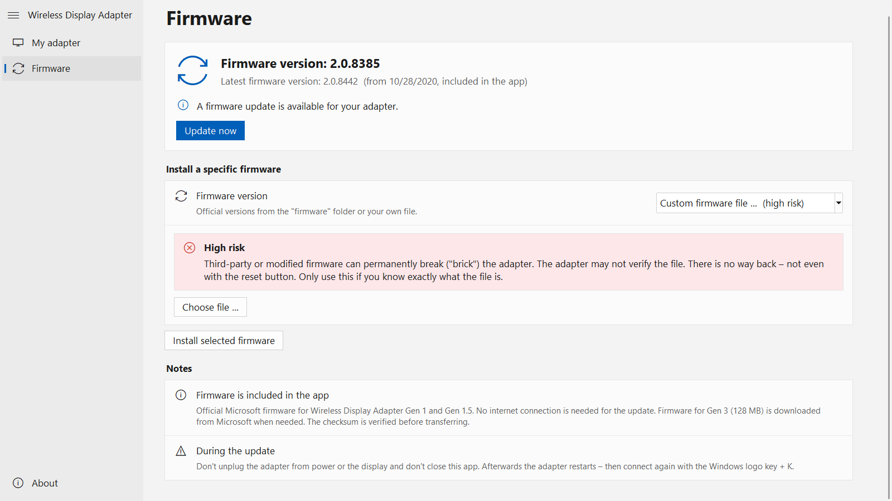

The last entry in the list is **Custom firmware file … (high risk)**. The app inspects the file
(size, SHA-256, header magic, the embedded build marker, presence of a bootloader) and shows
what it found plus anything suspicious, but it cannot validate an image the way the adapter
does. Third-party or modified firmware can brick the adapter permanently — not even the reset
button helps then. Because of that you have to type `RISK` to confirm. For Gen 3 a matching
signature file is required as well; the adapter rejects an unsigned image outright.

### Untested generations

Only the **Gen 1.5** (model 1733) adapter has been tested on real hardware. Gen 1 (`Type_S`,
model 1627) and Gen 3 follow exactly the same steps as the original Microsoft app, with
Microsoft's own firmware files, but the author owns neither device. The app says so instead of
hiding it:

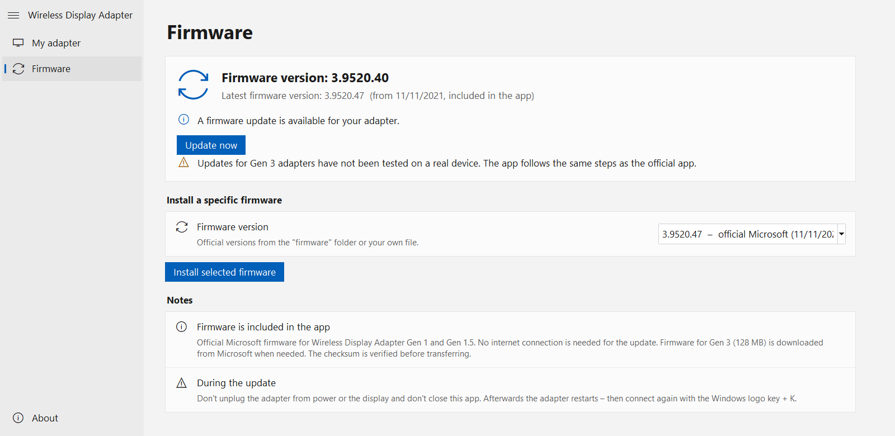

If you try one of them, please report whether it worked.


## 4. About

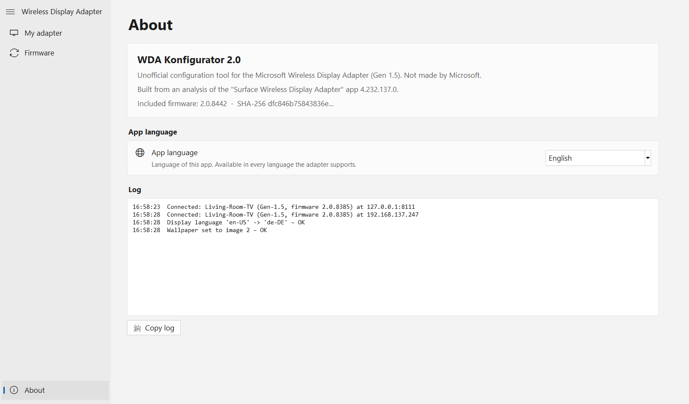

Version information and the log. Every action — connects, writes, downloads with their
checksums, errors — is recorded here, and **Copy log** puts it on the clipboard. That is the
text to attach to a bug report.


## 5. App language

The app itself is available in all 20 languages the adapter supports. Switch it on the **About**
page; the choice is saved to `%APPDATA%\WDA-Konfigurator\settings.json` and the UI redraws
immediately, including a font that suits the language.

| | |
|---|---|
| 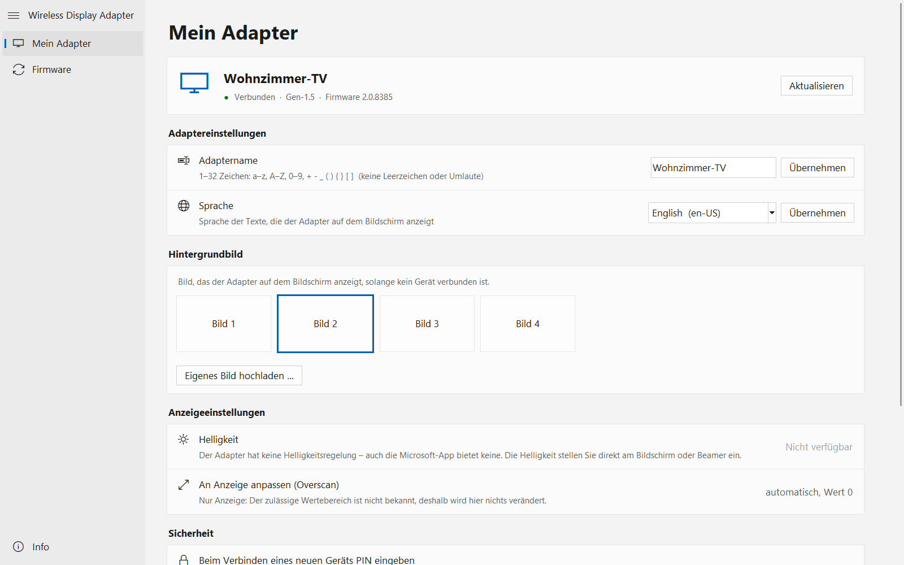 | 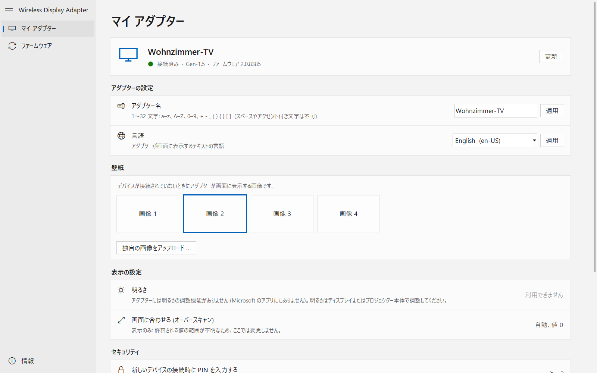 |

Light and dark mode follow the Windows setting automatically:

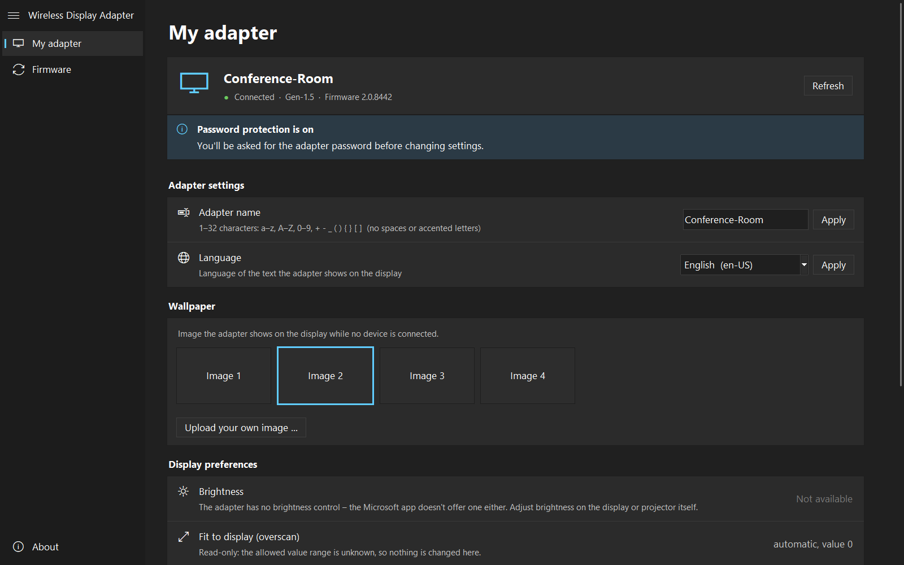


## 6. Command line

`wda_tool.py` does everything the GUI does, without the GUI. The host is a plain IP, optionally
with a port.

```bash
python wda_tool.py discover                          # ARP table, then a subnet scan
python wda_tool.py discover --udp 10                 # also listen for UDP heartbeats
python wda_tool.py discover --subnet 192.168.137.0/24

python wda_tool.py --host 192.168.137.247 info
python wda_tool.py --host 192.168.137.247 rename Room-1
python wda_tool.py --host 192.168.137.247 language          # list supported codes
python wda_tool.py --host 192.168.137.247 language de-DE
python wda_tool.py --host 192.168.137.247 overscan

python wda_tool.py firmware fetch --type Gen-1.5     # download from Microsoft, no adapter needed
python wda_tool.py --host 192.168.137.247 firmware check
python wda_tool.py --host 192.168.137.247 firmware update
```

Global flags, which must come **before** the subcommand:

| Flag | Effect |
|---|---|
| `--host <ip[:port]>` | the adapter to talk to |
| `--password <pw>` | the adapter password, if protection is on |
| `--yes` | don't ask for confirmation on writes |
| `--dry-run` | print what would be written, change nothing |
| `-v`, `--verbose` | print every HTTP request and response |

```bash
python wda_tool.py --host 192.168.137.247 --yes rename Room-1   # correct
python wda_tool.py --host 192.168.137.247 rename Room-1 --yes   # error
```

Every write asks first unless `--yes` is given. `firmware update` refuses to downgrade unless
you add `--force`, and `--timeout` (default 900 s) caps how long it waits for the install.

### Diagnostics

`wda_diag.py` records a connection attempt — ARP changes, RTSP connections on port 7236, HTTP
reachability of the adapter — and merges in the Windows WLAN event log afterwards. It is
read-only and writes a timeline to `diagnose-<timestamp>.txt`.

```bash
python wda_diag.py 300        # record for 300 s, then connect with Windows + K
```

This is the right tool for "it keeps disconnecting": the timeline shows whether the video link
dropped or only the web service stopped answering.


## 7. Troubleshooting

**The app doesn't find the adapter.** Is the Miracast session actually up (your screen on the
display)? The adapter is unreachable otherwise. Then try **Advanced search**. Over a wired
HDMI-extender setup rather than Miracast, pass the address directly to the CLI.

**"Connection unstable", dropping every ~13 s.** HDCP with firmware 2.0.8350. Update from
another PC, or disable HDCP support in the graphics driver.

**Error -4 (incorrect password).** Password protection is on. Enter it when asked, or pass
`--password` on the CLI. Forgotten: hold the reset button for 10 seconds.

**Error -3 (invalid device name).** The name rule is narrow — see §2.

**Error -13 (a previous firmware update is still running).** Give the adapter a few minutes, or
power-cycle it, then check the version before retrying.

**Error -1 on a Gen 3 update.** The image was sent without its signature file, or the two do
not belong together. Download both from Microsoft (`firmware fetch --type Gen-3`).

**The download fails.** Everything comes from `go.microsoft.com` redirects, and the tool
refuses redirects that leave `microsoft.com`. A proxy that rewrites them will break this by
design.

**"Firmware … is damaged (size/SHA-256 does not match)".** The stored copy no longer matches
its `firmware.json`. Delete that version folder and download it again.
